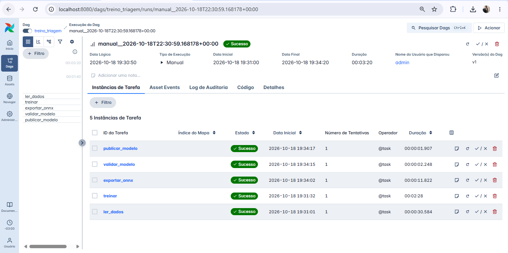
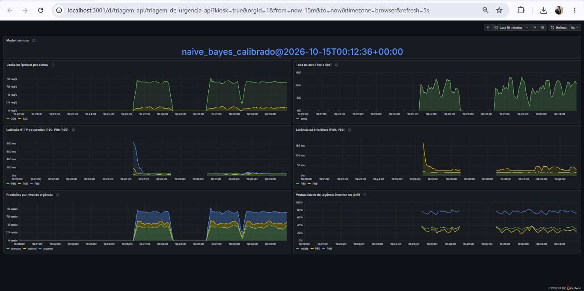

# Triagem de urgencia em laudos medicos


Tech Challenge - Fase 3 (Cloud and MLOps), PosTech FIAP Machine Learning Engineering.

Classificador de texto servido por API REST em container, com pipeline CI/CD,
orquestracao de treino e monitoramento.

Progresso em `docs/roadmap.md`; decisoes e justificativas em `docs/decisoes_tecnicas.md`.

## Problema

Um hospital de referencia precisa triar automaticamente laudos medicos em texto,
classificando a urgencia em tres niveis: `normal`, `atencao` e `urgente`. Triagem rapida
reduz o tempo ate o atendimento dos casos criticos.

## Dataset

[Medical Abstracts TC Corpus](https://github.com/sebischair/Medical-Abstracts-TC-Corpus)
(11.550 resumos de treino e 2.888 de teste, 5 categorias de doenca), licenca
[CC BY-SA 3.0](https://creativecommons.org/licenses/by-sa/3.0/). Os dados nao ficam no
repositorio: sao baixados por `python -m triagem.dados` e validados por SHA-256.

### Mapeamento categoria -> urgencia

O dataset classifica por **categoria de doenca**, nao por urgencia. Para atender ao
enunciado foi definido um mapeamento explicito:

| Urgencia | Categorias do dataset | Justificativa |
|---|---|---|
| `urgente` | cardiovascular, sistema nervoso | condicoes com eventos agudos (ex.: infarto, AVC) |
| `atencao` | neoplasias, digestivo | exigem investigacao e acompanhamento |
| `normal` | condicoes patologicas gerais | categoria generica, sem foco em evento agudo |

> **Limitacao:** o mapeamento e uma heuristica de dominio, nao um criterio clinico.
> Neoplasias, por exemplo, tambem podem ser graves. A API devolve tambem a categoria
> original prevista, e o mapeamento fica isolado em `src/triagem/urgencia.py` para
> poder ser revisado sem retreinar o modelo.

## Modelo

O modelo preve as 5 categorias do dataset (TF-IDF com unigramas e bigramas) e a urgencia
e derivada somando as probabilidades de cada grupo. Quatro candidatos sao comparados por
validacao cruzada (3 dobras) **somente no treino**; o conjunto de teste e usado uma unica
vez, apos a escolha. O criterio de selecao e o F1 macro de urgencia.

| Candidato | F1 urgencia | Recall urgente | Acuracia (5 categorias) |
|---|---|---|---|
| Regressao logistica | 0,598 | 0,713 | 0,555 |
| Naive Bayes (sem calibracao) | 0,543 | 0,855 | 0,600 |
| **Naive Bayes calibrado** | **0,637** | 0,760 | **0,602** |
| Random Forest | 0,453 | 0,824 | 0,519 |

O Naive Bayes sem calibracao tem boa acuracia de categoria, mas probabilidades pouco
confiaveis (planas), que distorcem a soma por nivel de urgencia e o limiar. A calibracao
isotonica corrige isso e leva o F1 de urgencia de 0,543 para 0,637. Os dois candidatos
estao na comparacao para que esse efeito possa ser verificado com `python -m triagem.treino`.

### Resultado final (conjunto de teste)

Em triagem, deixar de sinalizar um caso urgente e o erro mais caro. Por isso o limiar de
`urgente` e calibrado na validacao cruzada para um **recall alvo de 80%** (limiar 0,415).

| F1 urgencia | Recall urgente | Precisao urgente | Acuracia urgencia | Acuracia (5 categorias) |
|---|---|---|---|---|
| 0,628 | 0,823 | 0,660 | 0,655 | 0,595 |

Numeros do treino executado pela DAG do Airflow em container (ver "Retreino com Airflow").

> **Limitacoes assumidas:** a classe `normal` (condicoes patologicas gerais) tem recall de
> apenas 31%: muitos laudos `normal` sao escalados para `urgente`. Em triagem esse e o lado
> seguro do erro, mas gera carga extra de revisao. Este dataset e dificil (5 categorias com
> fronteiras difusas); o foco do trabalho e a engenharia do ciclo de vida do modelo, nao
> maximizar a acuracia.

### Reprodutibilidade

O treino e deterministico no codigo (sementes fixas, dados validados por SHA-256, versoes
travadas no `poetry.lock`), mas os numeros **nao sao identicos bit a bit entre ambientes**:
a soma em ponto flutuante das bibliotecas de algebra linear muda com a CPU e com a versao do
Python. Os valores acima sao os do **treino em container** (Linux, Python 3.11), que e a
referencia do projeto. Outras execucoes do mesmo codigo: Windows com Python 3.11, F1 de teste
0,628 (igual ao container); Linux com Python 3.13, F1 de teste 0,632 (limiar 0,414). Como o
container e o Windows, ambos com Python 3.11 e na mesma maquina, coincidem, a diferenca
acompanha a versao do Python ou a CPU, nao o sistema operacional; os dados disponiveis nao
separam as duas causas. A escolha do modelo e a conclusao sao as mesmas; espere diferencas de
ate cerca de 0,005. As versoes usadas em cada treino ficam em `artifacts/metadata.json`.

## API

Servidor FastAPI. Documentacao interativa (Swagger) em `http://localhost:8000/docs`.

```powershell
poetry run uvicorn triagem.api:criar_app --factory --port 8000
```

A API carrega o modelo de `artifacts/` ao iniciar e **recusa subir** se o artefato nao
existir ou se a versao do scikit-learn for diferente da usada no treino. O motor de inferencia
e escolhido por `TRIAGEM_BACKEND`: `sklearn` (padrao do codigo) ou `onnx` (padrao do
`docker-compose.yml`; ver "Otimizacao de latencia"). Com `onnx`, a API tambem recusa subir se
o `modelo.onnx` nao existir, nao for do mesmo treino do `modelo.joblib` ou tiver sido alterado.

**`POST /predict`**: classifica um laudo (1 a 10.000 caracteres).

```powershell
Invoke-RestMethod -Method Post -Uri http://localhost:8000/predict -ContentType "application/json" -Body '{"texto": "Patient with acute myocardial infarction and chest pain"}'
```

Resposta:

```json
{
  "urgencia": "urgente",
  "probabilidades_urgencia": {"normal": 0.12, "atencao": 0.21, "urgente": 0.67},
  "categoria": {"id": 4, "nome": "cardiovascular diseases", "probabilidade": 0.58},
  "limiar_urgente": 0.415,
  "versao_modelo": "naive_bayes_calibrado@2026-10-05T20:49:00+00:00"
}
```

Os valores acima ilustram o formato. Entrada invalida (vazia, acima do limite, sem
termos uteis) retorna `422`.

**`GET /health`**: confirma que o servico esta no ar e informa a versao do modelo.

**`GET /metrics`**: metricas no formato do Prometheus (ver "Monitoramento"). Fica fora da
documentacao Swagger.

> **Privacidade:** laudos sao dados sensiveis. O conteudo do texto **nunca** e registrado
> em log; so metodo, rota, status, duracao e um identificador da requisicao
> (`X-Request-ID`). Ferramenta de apoio a decisao: nao substitui avaliacao clinica.

## Docker

A imagem contem so o codigo e as dependencias de runtime. O **modelo nao fica na imagem**:
`artifacts/` e montado como volume somente leitura (decisao D-026), o que permite retreinar
sem rebuild. Sem o volume o container recusa subir.

```powershell
poetry run python -m triagem.treino   # gera artifacts/ (uma vez)
docker build -t triagem-api:dev .
docker run --rm -d --name triagem-api -p 8000:8000 -v "${PWD}\artifacts:/app/artifacts:ro" triagem-api:dev
```

Se a porta 8000 estiver ocupada, troque o numero da esquerda (`-p 8010:8000`). Conferir:

```powershell
docker ps                                       # STATUS deve chegar a "healthy"
Invoke-RestMethod http://localhost:8000/health
docker stop triagem-api
```

Caracteristicas da imagem (D-027): build em dois estagios (o Poetry nao chega na imagem
final), base `python:3.11-slim`, execucao com usuario sem privilegios (uid 10001),
`HEALTHCHECK` em `/health` e nenhum segredo ou dado no contexto de build (`.dockerignore`).

Tamanho medido da imagem: 490 MB na Etapa 1 e **583 MB** depois de incluir o ONNX Runtime
(`docker images`, descomprimido). O `docker run` acima usa o motor do scikit-learn, o padrao do
codigo; para usar o ONNX acrescente `-e TRIAGEM_BACKEND=onnx` (requer `artifacts/modelo.onnx`).

## Otimizacao de latencia (ONNX)

O modelo original (pipeline do scikit-learn) e convertido para **ONNX** e servido pelo ONNX
Runtime. A conversao e uma etapa explicita, com um **portao de paridade**: o arquivo so e
gravado depois de comparar, em 3.088 textos (os 2.888 do teste mais 200 variantes acentuadas),
as probabilidades e as decisoes de urgencia dos dois motores.

```powershell
poetry run python -m triagem.treino        # gera artifacts/modelo.joblib
poetry run python -m triagem.onnx_export   # gera artifacts/modelo.onnx e o confere
```

| Verificacao de paridade (original x ONNX) | Resultado | Limite do portao |
|---|---|---|
| Maior diferenca de probabilidade | 0,0103 | 0,02 |
| Diferenca media | 0,000006 | - |
| Urgencias diferentes | 0 de 3.088 | 0,1% |

O `modelo.onnx` tem 2,9 MB (o `modelo.joblib`, 9,1 MB). O `metadata.json` guarda o SHA-256 do
ONNX, o `treinado_em` do modelo a que ele pertence e o resultado da paridade; a API compara
tudo isso ao iniciar. Os limites do portao (0,02 e 0,1%) sao uma escolha minha de margem, nao
um criterio clinico; a maior diferenca observada foi metade do limite.

### Benchmark: original x otimizado

O script mede dois niveis: **inferencia** (so o modelo, no processo local) e **http**
(`POST /predict` da API em container). Requisicoes sequenciais, 100 de aquecimento descartadas
e 1.000 medidas por rodada, com 200 laudos reais do conjunto de teste sorteados com semente
fixa. Cada estatistica da tabela e a **mediana de 5 rodadas**; as rodadas ficam no JSON.

```powershell
docker compose up -d --build
poetry run python -m triagem.benchmark --url http://localhost:8010 --repeticoes 5 --rotulo onnx
```

Para o original, suba a API com `TRIAGEM_BACKEND=sklearn` (e rode o script com a mesma
variavel). Resultado (Windows 10, Python 3.11.9, 8 CPUs, Docker Desktop; as duas medicoes
foram feitas uma apos a outra na mesma maquina; `docs/benchmark_sklearn.json` e
`docs/benchmark_onnx.json`):

| Nivel | Motor | Media (ms) | P50 (ms) | P95 (ms) | P99 (ms) | Max (ms) |
|---|---|---|---|---|---|---|
| Inferencia (modelo) | original | 7,07 | 6,35 | 11,78 | 16,01 | 25,34 |
| Inferencia (modelo) | **ONNX** | 0,90 | 0,79 | 1,54 | 2,09 | 2,80 |
| HTTP (API em container) | original | 11,19 | 9,89 | 17,52 | 24,36 | 32,55 |
| HTTP (API em container) | **ONNX** | 6,13 | 5,45 | 10,22 | 13,56 | 38,58 |

| Ganho (original / ONNX) | P50 | P95 | P99 |
|---|---|---|---|
| Inferencia (modelo) | 8,0x | 7,6x | 7,7x |
| HTTP (API em container) | 1,8x | 1,7x | 1,8x |

**Por que 8x no modelo e so 1,8x na API:** o ONNX reduz a classificacao de ~6,3 para ~0,8 ms,
mas a requisicao HTTP inteira tem um custo que nao depende do motor (FastAPI, serializacao,
rede do Docker Desktop): a diferenca entre HTTP e inferencia no P50 e de ~3,5 ms no original e
~4,7 ms no ONNX. Depois da otimizacao, esse custo passa a ser o grosso do tempo. Ganhos
adicionais viriam dali, nao do modelo. A subtracao e so indicativa, porque a inferencia e
medida no Windows e o HTTP no container.

> **Como interpretar:**
> - O valor depende da maquina e serve para comparar os motores **na mesma maquina e na mesma
>   sessao**, nao como numero absoluto de producao. Uma medicao anterior do original, feita em
>   outra sessao, deu P50 de inferencia de 9,8 ms contra os 6,3 ms de agora: o ruido entre
>   sessoes no Windows e maior que o ruido entre rodadas, por isso a comparacao so vale dentro
>   da mesma sessao.
> - Entre as 5 rodadas, o P50 variou de 6,04 a 6,94 ms (original, inferencia), 0,78 a 0,85 ms
>   (ONNX, inferencia), 9,40 a 10,12 ms (original, HTTP) e 4,96 a 5,88 ms (ONNX, HTTP). As
>   faixas nao se sobrepoem entre os motores. P99 e maximo oscilam mais, por serem caudas; o
>   maximo do HTTP com ONNX chegou a 58 ms em duas rodadas, um pico isolado, nao uma regressao.
> - O cliente envia cada requisicao em uma unica escrita: com o `http.client` padrao (duas
>   escritas) o Docker Desktop no Windows chegou a 57 ms por requisicao contra 11 ms (D-028).

**Limitacoes assumidas do ONNX** (detalhes e justificativas em D-033):
- A conversao automatica do `skl2onnx` **nao e fiel** neste pipeline: tres divergencias foram
  encontradas e corrigidas no codigo (formula do TF-IDF sublinear, calibracao isotonica e
  tokens nao ASCII). O portao de paridade existe justamente para falhar alto se uma
  atualizacao do conversor reintroduzir o problema.
- Palavras nao ASCII sao tratadas por uma solucao de contorno (mapeadas para um termo
  reservado, que o modelo ignora). A paridade foi medida com 200 textos acentuados, mas e uma
  amostra, nao uma garantia para qualquer texto.
- A normalizacao do texto continua em Python (D-016) e o modelo ONNX e gerado de um treino
  especifico: um retreino exige reexportar (a DAG faz isso).

## CI/CD (GitHub Actions)

Dois workflows em `.github/workflows/`, executados a cada push na `main` e em pull requests:

| Workflow | Job | O que faz |
|---|---|---|
| `ci.yml` | `lint` | `ruff check` e `ruff format --check` |
| `ci.yml` | `test` | `pytest` (Python 3.11, mesma versao da imagem) |
| `ci.yml` | `build` | `docker build` da imagem da API, sem publicar |
| `seguranca.yml` | `gitleaks` | varredura de segredos em todo o historico; tambem roda toda segunda-feira |

Permissoes minimas (`contents: read`), cancelamento de execucoes antigas da mesma branch e
Poetry na mesma versao do Dockerfile (2.4.1). O primeiro push com os workflows passou nos
quatro jobs (CI em 1 min 44 s).

> **Limitacao:** o job `build` so prova que a imagem constroi. Nao sobe a API, porque sem o
> modelo ela recusa iniciar (D-026); o comportamento da API e coberto pelo `pytest`. Detalhes
> em D-030.

## Retreino com Airflow

A DAG `treino_triagem` (`airflow/dags/treino_triagem.py`) retreina o modelo e o publica no
diretorio que a API le:

```text
ler_dados -> treinar -> exportar_onnx -> validar_modelo -> publicar_modelo
```

| Tarefa | O que faz |
|---|---|
| `ler_dados` | baixa o dataset (se preciso), confere o SHA-256 e valida os CSVs |
| `treinar` | compara os candidatos, escolhe o melhor e grava em um **staging** |
| `exportar_onnx` | converte o modelo recem-treinado para ONNX **no staging** e roda o portao de paridade (D-033) |
| `validar_modelo` | **portao de qualidade**: o modelo precisa carregar nos dois motores (scikit-learn e ONNX), classificar com a mesma urgencia e atingir F1 de urgencia >= 0,55 e recall urgente >= 0,75 no teste |
| `publicar_modelo` | troca os arquivos (ONNX, modelo e metadados) por renomeacao atomica e remove o staging |

Um modelo reprovado ou um treino interrompido **nunca substitui o modelo em uso**. O disparo
e manual (`schedule=None`): o dataset nao muda, entao retreinar sem motivo nao melhora o
modelo. Os minimos podem ser alterados no disparo (parametros `f1_minimo` e `recall_minimo`).

```powershell
docker compose -f docker-compose.airflow.yml up -d --build
docker compose -f docker-compose.airflow.yml logs airflow | Select-String "Password"
```

Abra http://localhost:8080 (usuario `admin`, senha do comando acima), dispare a DAG
`treino_triagem` e aguarde. Para desligar: `docker compose -f docker-compose.airflow.yml down`.
O primeiro build baixa a imagem do Airflow (mais de 1 GB).

O treino do container levou 2 min 28 s e a exportacao para ONNX
cerca de 12 s. O modelo publicado e lido pela API do mesmo diretorio `artifacts/` (D-026); isso foi
verificado: a API do compose, reiniciada depois da DAG, subiu em modo ONNX com a versao gravada
pela DAG (`...+onnx`).

Execucao aprovada (as 5 tarefas, 3 min 20 s):



A primeira versao da DAG, com 4 tarefas (antes do ONNX), esta em `docs/img/airflow_dag_sucesso.png`.

Execucao com o portao em `f1_minimo = 0.99` (feita na versao de 4 tarefas, antes do ONNX):
`validar_modelo` reprova, `publicar_modelo` nao roda e o modelo em uso continua o mesmo (o
modelo reprovado fica em `artifacts/.staging/` para diagnostico):


> **Limitacoes assumidas:** o Airflow roda em modo `standalone` (um container, SQLite), o
> que atende ao desafio mas nao e uma arquitetura de producao. A interface fica restrita a
> `127.0.0.1` e usa o gerenciador de autenticacao simples, que o proprio Airflow avisa nao ser
> recomendado para producao. Como sao tres arquivos (ONNX, modelo e metadados), ha uma janela de
> milissegundos entre as trocas; a API so le o modelo ao iniciar e confere o ONNX contra os
> metadados, entao o risco se limita a um restart exatamente nesse instante (e o resultado
> seria a recusa de subir, nao uma resposta errada). Detalhes em D-029.

## Monitoramento (Prometheus e Grafana)

O `docker-compose.yml` sobe a API, o **Prometheus** (coleta `/metrics` a cada 5 s) e o
**Grafana**, que ja abre num dashboard provisionado a partir de arquivos versionados
(`monitoring/grafana/dashboards/triagem.json`): nao ha nada para configurar na interface.

```powershell
poetry run python -m triagem.treino        # se ainda nao existir artifacts/
poetry run python -m triagem.onnx_export   # o compose usa o motor ONNX
cp .env.example .env
```

Edite o `.env` (o padrao `TRIAGEM_BACKEND=onnx` ja serve; use `sklearn` para o motor original)
e preencha `GRAFANA_ADMIN_PASSWORD` com a senha que preferir: ela **nao tem
valor padrao** e, sem ela, o compose recusa subir. Depois:

```powershell
docker compose up -d --build
poetry run python -m triagem.carga   # gera trafego por 2 minutos
```

O primeiro `up --build` leva alguns minutos (cerca de 5 na validacao em clone limpo, contando o
download das imagens do Prometheus e do Grafana); os seguintes usam o cache.

| Servico | Endereco | Observacao |
|---|---|---|
| API | http://localhost:8000 | porta em `API_PORT` |
| Prometheus | http://localhost:9090 | `PROMETHEUS_PORT`; em *Status > Target health* o alvo `triagem-api` deve estar UP |
| Grafana | http://localhost:3000 | `GRAFANA_PORT`; usuario `admin`, senha do `.env` |

Todas as portas ficam presas a `127.0.0.1`. Se alguma ja estiver em uso na sua maquina,
mude-a no `.env` (e use a mesma porta no gerador: `--url http://localhost:<API_PORT>`). Para
desligar: `docker compose down` (acrescente `-v` para apagar tambem os dados do Prometheus e
do Grafana).

Dashboard com o gerador de carga rodando (10 req/s, 10% de requisicoes invalidas):



| Painel | O que mostra | Metrica |
|---|---|---|
| Modelo em uso | versao carregada pela API | `triagem_modelo_info` |
| Vazao de `/predict` por status | req/s por codigo HTTP (200, 422, ...) | `http_requests_total` |
| Taxa de erro | fracao de respostas 4xx e 5xx | `http_requests_total` |
| Latencia HTTP (P50, P95, P99) | tempo de resposta visto pelo servidor | `http_request_duration_seconds` |
| Latencia da inferencia (P50, P95) | so a classificacao, sem a camada HTTP; o que o ONNX deve reduzir | `triagem_inferencia_duration_seconds` |
| Predicoes por nivel de urgencia | mistura `normal` / `atencao` / `urgente` | `triagem_predicoes_total` |
| Probabilidade de urgencia | media, P50 e P90 da probabilidade de `urgente` (sinal de drift) | `triagem_probabilidade_urgente` |

O gerador (`python -m triagem.carga`) usa laudos reais do conjunto de teste e uma fracao de
entradas invalidas, para o painel de erros mostrar algo alem de zero. Parametros:
`--duracao`, `--taxa`, `--invalidas`, `--url`.

**Privacidade e cardinalidade:** nenhuma metrica recebe o texto do laudo e os rotulos tem
poucos valores possiveis (a rota vai pelo *template*, nunca pelo caminho cru). Ha testes para
os dois pontos. Detalhes em D-031 e D-032.

**Validado:** a stack subiu no Docker Desktop com Prometheus v3.13.4 e Grafana 12.4.13; o
alvo ficou UP, e com 2.400 requisicoes do gerador os 7 paineis mostraram dados. As consultas
do dashboard tambem foram executadas contra um Prometheus real, e um teste da suite falha se
o dashboard citar uma metrica que a API nao expoe.

> **Limitacoes assumidas:**
> - Os percentis do Prometheus sao **estimativas** por interpolacao entre faixas (*buckets*)
>   do histograma; nao coincidem exatamente com os do benchmark (D-028), que mede no cliente,
>   requisicao a requisicao.
> - As primeiras requisicoes depois de um periodo ocioso sao mais lentas (aquecimento): no
>   inicio de cada execucao do gerador o P99 chegou a ~800 ms antes de cair para poucas
>   dezenas de ms.
> - **Drift:** em producao nao ha rotulos, entao o painel de probabilidade e um sinal
>   *indireto*: um deslocamento persistente sugere mudanca nos dados ou no modelo, mas nao a
>   prova nem mede a perda de acuracia.
> - As metricas pressupoem **uma unica worker** do uvicorn (a configuracao da imagem). Com
>   varias, seria preciso o modo multiprocesso do `prometheus_client`.
> - **Sem alertas:** nao fazem parte do escopo do desafio; o dashboard e para observacao.
> - O Grafana usa a senha do `.env`; o Prometheus nao tem autenticacao e so e acessivel
>   a partir da propria maquina.

## Arquitetura em nuvem (decisao)

Esta secao e uma **decisao documentada**: nada abaixo foi implantado nem testado na nuvem.
A aplicacao roda localmente em Docker, e o que foi validado esta nas secoes anteriores.

### O problema decide o modo de execucao

O sistema tem dois componentes com necessidades opostas, e a pergunta util nao e "batch ou
tempo real?", e sim qual modo atende cada componente:

| Componente | Requisito real | Modo escolhido | Por que |
|---|---|---|---|
| Classificar um laudo (`/predict`) | resposta imediata, a triagem decide quem e atendido primeiro | **tempo real** | um lote noturno nao serve: o valor do sistema esta em sinalizar o caso urgente na hora |
| Retreinar o modelo | sem pressa; o dataset nao muda e o disparo e manual | **batch** | executa, termina e deixa de custar; falha se resolve reexecutando |
| Coletar metricas | continuo, leve | servico gerenciado | ja expomos `/metrics` no padrao Prometheus |

| Eixo | Batch | Tempo real | Serverless |
|---|---|---|---|
| Latencia | alta, tolerada | baixa e previsivel | variavel (partida a frio) |
| Custo | menor, sem ociosidade | maior, infraestrutura permanente | bom para carga intermitente |
| Tolerancia a falhas | alta, basta reexecutar | baixa, o impacto e imediato | media, com novas tentativas automaticas |
| Atualizacao do modelo | controlada, reversao simples | exige implantacao gradual e versionamento | rapida |

### Escolha: Google Cloud Platform

AWS, Azure e GCP resolvem este cenario com servicos equivalentes; a escolha do GCP e de
**simplicidade**, nao de superioridade tecnica: o **Cloud Run** executa a imagem Docker que ja
existe, sem reescrever a aplicacao, e o **Cloud Run Jobs** executa a mesma imagem como tarefa
batch. Equivalentes: AWS (ECS Fargate ou App Runner + AWS Batch) e Azure (Container Apps +
Container Apps Jobs).

| Funcao | Servico (GCP) | Observacao |
|---|---|---|
| API de inferencia (tempo real) | Cloud Run | a imagem escuta na porta 8000; no Cloud Run basta configurar essa porta |
| Imagem do container | Artifact Registry | o CI hoje so constroi a imagem (D-030); publicar seria um passo novo |
| Retreino (batch) | Cloud Run Jobs, disparado por Cloud Scheduler ou manualmente | executa treino, exportacao ONNX e validacao; o codigo ja esta fora da DAG (D-029) e e reaproveitado |
| Modelo e dados | Cloud Storage | modelo versionado por treino; a API leria o bucket montado como volume somente leitura (mantem a decisao D-026) |
| Metricas e dashboards | Managed Service for Prometheus + Cloud Monitoring (ou Grafana apontando para ele) | `/metrics` ja existe; no Cloud Run a coleta exigiria um coletor auxiliar |
| Segredos | Secret Manager | hoje a unica senha e a do Grafana, no `.env` local |

**Por que nao o Cloud Composer (Airflow gerenciado)?** Para uma unica DAG, o custo fixo de um
ambiente permanente nao se justifica; um job agendado entrega o mesmo resultado. O Airflow
continua no projeto (e o que a disciplina pede e o que foi validado), e a DAG local e o
retorno natural caso o numero de pipelines cresca. **Por que nao Vertex AI?** E um servico
gerenciado completo para modelos; para um modelo de 3 MB servido por um container proprio
acrescentaria custo e dependencia do fornecedor sem ganho aqui.

### Trade-offs e riscos assumidos

- **Partida a frio.** Cloud Run pode reduzir a zero instancias; a primeira requisicao depois
  de ociosidade paga o tempo de subir o container e carregar o modelo (a API carrega o modelo
  ao iniciar, D-023). Para triagem isso nao e aceitavel: a recomendacao e manter **ao menos uma
  instancia ativa**, pagando um custo base pequeno em troca de latencia previsivel.
- **Custo (FinOps).** Cloud Run cobra por uso, o job batch nao custa quando nao esta rodando, e
  a imagem enxuta (583 MB) reduz o tempo de subida. Recomenda-se um orcamento com alerta, um
  projeto separado para desenvolvimento e producao e etiquetas de custo por servico. Nao
  estimei valores: dependem de volume e preco vigente, e eu nao medi.
- **Dados de saude.** Laudos sao dados pessoais sensiveis (LGPD). A recomendacao e: regiao no
  Brasil (`southamerica-east1`), acesso autenticado (sem acesso publico), conta de servico com
  o minimo de permissoes e nenhum texto de laudo em log ou metrica (ja garantido e testado,
  D-022 e D-031). Uso real com dados de pacientes exigiria avaliacao juridica e clinica que
  este trabalho nao fez.
- **Uma instancia nao e alta disponibilidade.** Escalar a API exige reavaliar as metricas, que
  hoje pressupoem uma unica worker (D-031).

### O que falta para implantar de fato

Publicar a imagem no Artifact Registry a partir do CI, criar o bucket e o servico, configurar
autenticacao e orcamento, e sobrepor o Prometheus gerenciado ao dashboard. Nenhum desses passos
foi feito.

## Ambiente de desenvolvimento

O projeto precisa ficar fora do OneDrive (ex.: `C:\dev\tech-challenge-fase3`).
Caminhos com acento quebram a criacao do `.venv` no Windows.

```powershell
poetry install
poetry run pre-commit install
cp .env.example .env
poetry run ruff check .
poetry run ruff format --check .
poetry run pytest
poetry run python -m triagem.dados    # baixa e valida o dataset
poetry run python -m triagem.treino   # compara modelos, treina e gera artifacts/
poetry run python -m triagem.onnx_export   # converte para ONNX e confere a paridade
```

## Uso de IA no desenvolvimento

Este projeto foi desenvolvido com o assistente de IA **Claude** (Anthropic), usado como
parceiro de engenharia: propunha a implementacao e as alternativas, e escrevia codigo, testes e
documentacao. O autor definiu o escopo e as decisoes e executou e conferiu o resultado na
propria maquina (testes, containers, Grafana, Airflow, benchmarks). Os commits trazem o
trailer `Co-Authored-By` por isso.

Duas consequencias praticas: os numeros do README vem de execucoes reais (os JSONs de
benchmark e as metricas em `artifacts/metadata.json` estao no repositorio), e o que **nao foi
validado** esta dito como tal nas limitacoes de cada secao (por exemplo, a arquitetura em
nuvem e apenas uma decisao documentada).

## Licencas e atribuicao

O dataset [Medical Abstracts TC Corpus](https://github.com/sebischair/Medical-Abstracts-TC-Corpus)
e distribuido sob [CC BY-SA 3.0](https://creativecommons.org/licenses/by-sa/3.0/) e nao e
copiado para este repositorio: e baixado e verificado por SHA-256 (`python -m triagem.dados`).
O modelo treinado e os artefatos tambem nao sao versionados (D-013).
