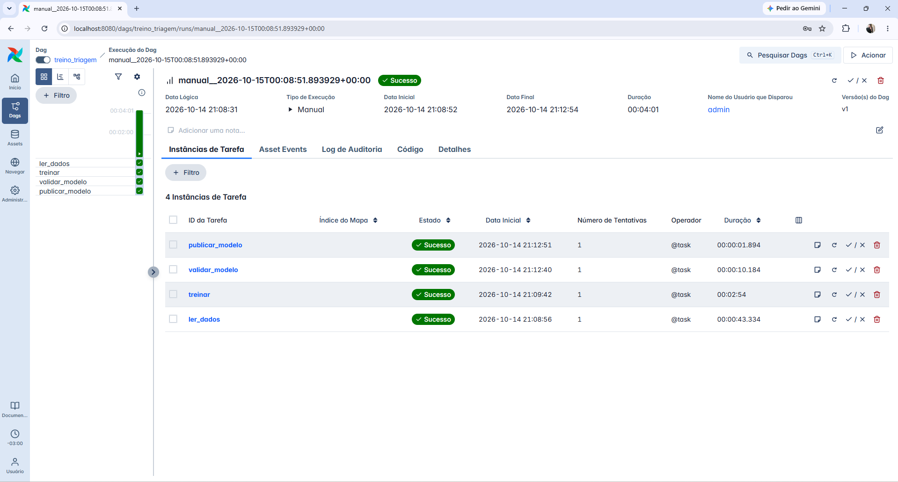
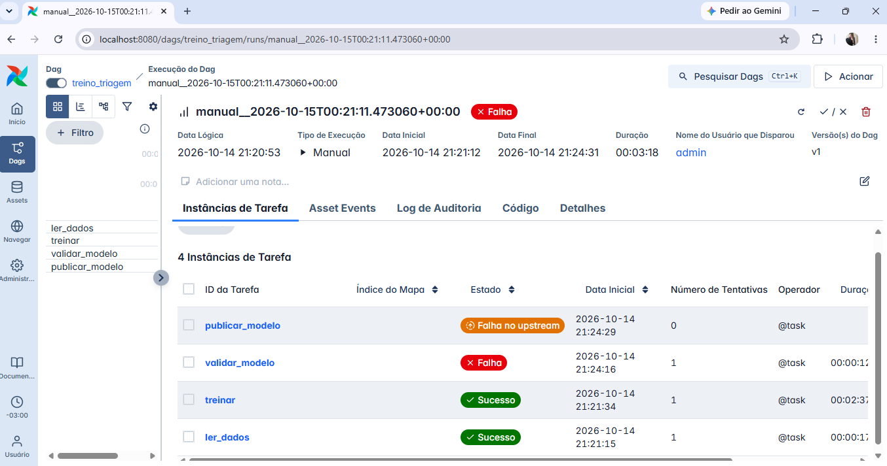

# Triagem de urgencia em laudos medicos


Tech Challenge - Fase 3 (Cloud and MLOps), PosTech FIAP Machine Learning Engineering.

Classificador de texto servido por API REST em container, com pipeline CI/CD,
orquestracao de treino e monitoramento.

> Em construcao. O monitoramento (Prometheus e Grafana), a otimizacao do modelo (ONNX) e a
> decisao de arquitetura em nuvem entram nos proximos blocos. Progresso em
> `docs/roadmap.md`; decisoes e justificativas em `docs/decisoes_tecnicas.md`.

## Problema

Um hospital de referencia precisa triar automaticamente laudos medicos em texto,
classificando a urgencia em tres niveis: `normal`, `atencao` e `urgente`. Triagem rapida
reduz o tempo ate o atendimento dos casos criticos.

## Dataset

[Medical Abstracts TC Corpus](https://github.com/sebischair/Medical-Abstracts-TC-Corpus)
(11.550 resumos de treino e 2.888 de teste, 5 categorias de doenca), licenca
[CC BY-SA 3.0](https://creativecommons.org/licenses/by-sa/3.0/). Os dados nao ficam no
repositorio: sao baixados por `python -m triagem.dados` e validados por SHA-256.

### Mapeamento categoria -> urgencia

O dataset classifica por **categoria de doenca**, nao por urgencia. Para atender ao
enunciado foi definido um mapeamento explicito:

| Urgencia | Categorias do dataset | Justificativa |
|---|---|---|
| `urgente` | cardiovascular, sistema nervoso | condicoes com eventos agudos (ex.: infarto, AVC) |
| `atencao` | neoplasias, digestivo | exigem investigacao e acompanhamento |
| `normal` | condicoes patologicas gerais | categoria generica, sem foco em evento agudo |

> **Limitacao:** o mapeamento e uma heuristica de dominio, nao um criterio clinico.
> Neoplasias, por exemplo, tambem podem ser graves. A API devolve tambem a categoria
> original prevista, e o mapeamento fica isolado em `src/triagem/urgencia.py` para
> poder ser revisado sem retreinar o modelo.

## Modelo

O modelo preve as 5 categorias do dataset (TF-IDF com unigramas e bigramas) e a urgencia
e derivada somando as probabilidades de cada grupo. Quatro candidatos sao comparados por
validacao cruzada (3 dobras) **somente no treino**; o conjunto de teste e usado uma unica
vez, apos a escolha. O criterio de selecao e o F1 macro de urgencia.

| Candidato | F1 urgencia | Recall urgente | Acuracia (5 categorias) |
|---|---|---|---|
| Regressao logistica | 0,598 | 0,713 | 0,555 |
| Naive Bayes (sem calibracao) | 0,543 | 0,855 | 0,600 |
| **Naive Bayes calibrado** | **0,637** | 0,760 | **0,602** |
| Random Forest | 0,453 | 0,824 | 0,519 |

O Naive Bayes sem calibracao tem boa acuracia de categoria, mas probabilidades pouco
confiaveis (planas), que distorcem a soma por nivel de urgencia e o limiar. A calibracao
isotonica corrige isso e leva o F1 de urgencia de 0,543 para 0,637. Os dois candidatos
estao na comparacao para que esse efeito possa ser verificado com `python -m triagem.treino`.

### Resultado final (conjunto de teste)

Em triagem, deixar de sinalizar um caso urgente e o erro mais caro. Por isso o limiar de
`urgente` e calibrado na validacao cruzada para um **recall alvo de 80%** (limiar 0,415).

| F1 urgencia | Recall urgente | Precisao urgente | Acuracia urgencia | Acuracia (5 categorias) |
|---|---|---|---|---|
| 0,628 | 0,823 | 0,660 | 0,655 | 0,595 |

Numeros do treino executado pela DAG do Airflow em container (ver "Retreino com Airflow").

> **Limitacoes assumidas:** a classe `normal` (condicoes patologicas gerais) tem recall de
> apenas 31%: muitos laudos `normal` sao escalados para `urgente`. Em triagem esse e o lado
> seguro do erro, mas gera carga extra de revisao. Este dataset e dificil (5 categorias com
> fronteiras difusas); o foco do trabalho e a engenharia do ciclo de vida do modelo, nao
> maximizar a acuracia.

### Reprodutibilidade

O treino e deterministico no codigo (sementes fixas, dados validados por SHA-256, versoes
travadas no `poetry.lock`), mas os numeros **nao sao identicos bit a bit entre ambientes**:
a soma em ponto flutuante das bibliotecas de algebra linear muda com a CPU e com a versao do
Python. Os valores acima sao os do **treino em container** (Linux, Python 3.11), que e a
referencia do projeto. Outras execucoes do mesmo codigo: Windows com Python 3.11, F1 de teste
0,628 (igual ao container); Linux com Python 3.13, F1 de teste 0,632 (limiar 0,414). Como o
container e o Windows, ambos com Python 3.11 e na mesma maquina, coincidem, a diferenca
acompanha a versao do Python ou a CPU, nao o sistema operacional; os dados disponiveis nao
separam as duas causas. A escolha do modelo e a conclusao sao as mesmas; espere diferencas de
ate cerca de 0,005. As versoes usadas em cada treino ficam em `artifacts/metadata.json`.

## API

Servidor FastAPI. Documentacao interativa (Swagger) em `http://localhost:8000/docs`.

```powershell
poetry run uvicorn triagem.api:criar_app --factory --port 8000
```

A API carrega o modelo de `artifacts/` ao iniciar e **recusa subir** se o artefato nao
existir ou se a versao do scikit-learn for diferente da usada no treino.

**`POST /predict`**: classifica um laudo (1 a 10.000 caracteres).

```powershell
Invoke-RestMethod -Method Post -Uri http://localhost:8000/predict -ContentType "application/json" -Body '{"texto": "Patient with acute myocardial infarction and chest pain"}'
```

Resposta:

```json
{
  "urgencia": "urgente",
  "probabilidades_urgencia": {"normal": 0.12, "atencao": 0.21, "urgente": 0.67},
  "categoria": {"id": 4, "nome": "cardiovascular diseases", "probabilidade": 0.58},
  "limiar_urgente": 0.415,
  "versao_modelo": "naive_bayes_calibrado@2026-10-05T20:49:00+00:00"
}
```

Os valores acima ilustram o formato. Entrada invalida (vazia, acima do limite, sem
termos uteis) retorna `422`.

**`GET /health`**: confirma que o servico esta no ar e informa a versao do modelo.

> **Privacidade:** laudos sao dados sensiveis. O conteudo do texto **nunca** e registrado
> em log; so metodo, rota, status, duracao e um identificador da requisicao
> (`X-Request-ID`). Ferramenta de apoio a decisao: nao substitui avaliacao clinica.

## Docker

A imagem contem so o codigo e as dependencias de runtime. O **modelo nao fica na imagem**:
`artifacts/` e montado como volume somente leitura (decisao D-026), o que permite retreinar
sem rebuild. Sem o volume o container recusa subir.

```powershell
poetry run python -m triagem.treino   # gera artifacts/ (uma vez)
docker build -t triagem-api:dev .
docker run --rm -d --name triagem-api -p 8000:8000 -v "${PWD}\artifacts:/app/artifacts:ro" triagem-api:dev
```

Se a porta 8000 estiver ocupada, troque o numero da esquerda (`-p 8010:8000`). Conferir:

```powershell
docker ps                                       # STATUS deve chegar a "healthy"
Invoke-RestMethod http://localhost:8000/health
docker stop triagem-api
```

Caracteristicas da imagem (D-027): build em dois estagios (o Poetry nao chega na imagem
final), base `python:3.11-slim`, execucao com usuario sem privilegios (uid 10001),
`HEALTHCHECK` em `/health` e nenhum segredo ou dado no contexto de build (`.dockerignore`).

Tamanho medido da imagem: 490 MB (`docker images`, descomprimido).

## Latencia (baseline do modelo original)

Referencia para a comparacao com o modelo otimizado (ONNX, Etapa 4). O script mede dois
niveis: **inferencia** (so o modelo, no processo local) e **http** (`POST /predict` da API em
container). Requisicoes sequenciais, 100 de aquecimento descartadas e 1.000 medidas, usando
200 laudos reais do conjunto de teste sorteados com semente fixa.

```powershell
docker run --rm -d --name triagem-api -p 8010:8000 -v "${PWD}\artifacts:/app/artifacts:ro" triagem-api:dev
poetry run python -m triagem.benchmark --url http://localhost:8010
docker stop triagem-api
```

Resultado (Windows 10, Python 3.11.9, 8 CPUs, Docker Desktop; `docs/benchmark_sklearn.json`):

| Nivel | Media (ms) | P50 (ms) | P95 (ms) | P99 (ms) | Max (ms) |
|---|---|---|---|---|---|
| Inferencia (modelo) | 10,9 | 9,8 | 17,5 | 23,1 | 43,3 |
| HTTP (API em container) | 14,2 | 12,8 | 24,5 | 32,9 | 44,8 |

O HTTP soma cerca de 3 ms (P50) sobre a inferencia: FastAPI, serializacao e rede do Docker.

> **Como interpretar:** o valor depende da maquina e serve para comparar o modelo original com
> o otimizado **na mesma maquina**, nao como numero absoluto de producao. P50 e P95 variaram
> pouco entre execucoes (P50 de inferencia entre 9,1 e 9,8 ms; de HTTP entre 12,8 e 13,1 ms);
> P99 e maximo oscilam mais, por serem caudas. O cliente envia cada requisicao em uma unica
> escrita: com o `http.client` padrao (duas escritas) o Docker Desktop no Windows chegou a
> 57 ms por requisicao contra 11 ms (detalhes e medicoes em D-028).

## CI/CD (GitHub Actions)

Dois workflows em `.github/workflows/`, executados a cada push na `main` e em pull requests:

| Workflow | Job | O que faz |
|---|---|---|
| `ci.yml` | `lint` | `ruff check` e `ruff format --check` |
| `ci.yml` | `test` | `pytest` (Python 3.11, mesma versao da imagem) |
| `ci.yml` | `build` | `docker build` da imagem da API, sem publicar |
| `seguranca.yml` | `gitleaks` | varredura de segredos em todo o historico; tambem roda toda segunda-feira |

Permissoes minimas (`contents: read`), cancelamento de execucoes antigas da mesma branch e
Poetry na mesma versao do Dockerfile (2.4.1). O primeiro push com os workflows passou nos
quatro jobs (CI em 1 min 44 s).

> **Limitacao:** o job `build` so prova que a imagem constroi. Nao sobe a API, porque sem o
> modelo ela recusa iniciar (D-026); o comportamento da API e coberto pelo `pytest`. Detalhes
> em D-030.

## Retreino com Airflow

A DAG `treino_triagem` (`airflow/dags/treino_triagem.py`) retreina o modelo e o publica no
diretorio que a API le:

```text
ler_dados -> treinar -> validar_modelo -> publicar_modelo
```

| Tarefa | O que faz |
|---|---|
| `ler_dados` | baixa o dataset (se preciso), confere o SHA-256 e valida os CSVs |
| `treinar` | compara os candidatos, escolhe o melhor e grava em um **staging** |
| `validar_modelo` | **portao de qualidade**: o modelo precisa carregar, classificar e atingir F1 de urgencia >= 0,55 e recall urgente >= 0,75 no teste |
| `publicar_modelo` | troca os arquivos do modelo por renomeacao atomica e remove o staging |

Um modelo reprovado ou um treino interrompido **nunca substitui o modelo em uso**. O disparo
e manual (`schedule=None`): o dataset nao muda, entao retreinar sem motivo nao melhora o
modelo. Os minimos podem ser alterados no disparo (parametros `f1_minimo` e `recall_minimo`).

```powershell
docker compose -f docker-compose.airflow.yml up -d --build
docker compose -f docker-compose.airflow.yml logs airflow | Select-String "Password"
```

Abra http://localhost:8080 (usuario `admin`, senha do comando acima), dispare a DAG
`treino_triagem` e aguarde. Para desligar: `docker compose -f docker-compose.airflow.yml down`.
O primeiro build baixa a imagem do Airflow (mais de 1 GB).

O treino do container leva cerca de 4 minutos (Random Forest: ~3 min). O modelo publicado e lido
pela API do mesmo diretorio `artifacts/` (D-026); isso foi verificado: a API subiu e classificou
com o modelo gravado pela DAG.

Execucao aprovada (as 4 tarefas, 4 min 01 s):



Execucao com o portao em `f1_minimo = 0.99`: `validar_modelo` reprova, `publicar_modelo` nao
roda e o modelo em uso continua o mesmo (o modelo reprovado fica em `artifacts/.staging/` para
diagnostico):



> **Limitacoes assumidas:** o Airflow roda em modo `standalone` (um container, SQLite), o
> que atende ao desafio mas nao e uma arquitetura de producao. A interface fica restrita a
> `127.0.0.1` e usa o gerenciador de autenticacao simples, que o proprio Airflow avisa nao ser
> recomendado para producao. Como sao dois arquivos (modelo e metadados), ha uma janela de
> milissegundos entre as duas trocas; a API so le o modelo ao iniciar, entao o risco se limita
> a um restart exatamente nesse instante. Detalhes em D-029.

## Ambiente de desenvolvimento

O projeto precisa ficar fora do OneDrive (ex.: `C:\dev\tech-challenge-fase3`).
Caminhos com acento quebram a criacao do `.venv` no Windows.

```powershell
poetry install
poetry run pre-commit install
cp .env.example .env
poetry run ruff check .
poetry run ruff format --check .
poetry run pytest
poetry run python -m triagem.dados    # baixa e valida o dataset
poetry run python -m triagem.treino   # compara modelos, treina e gera artifacts/
```
